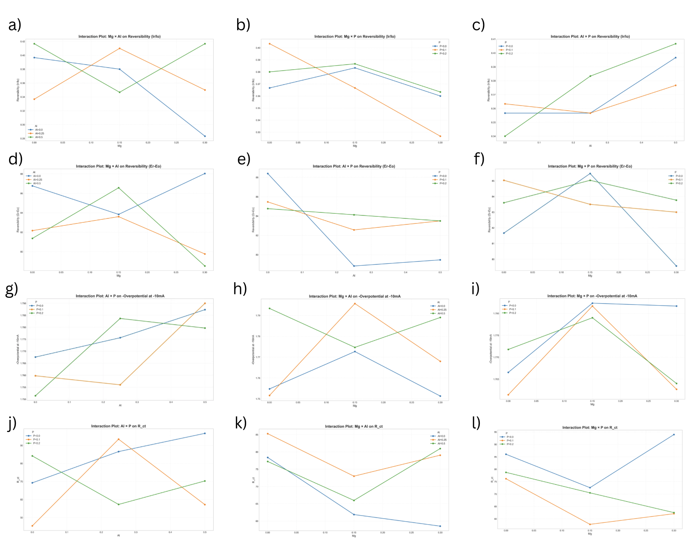
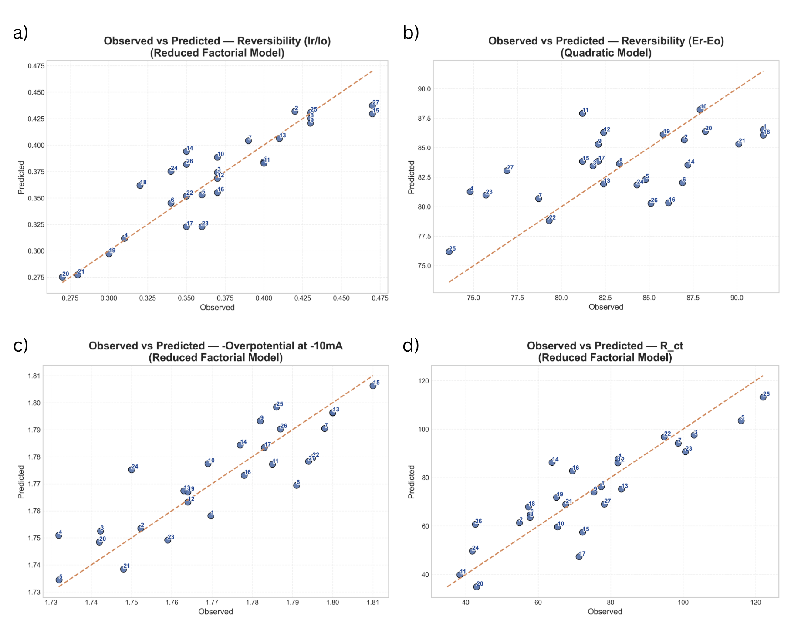
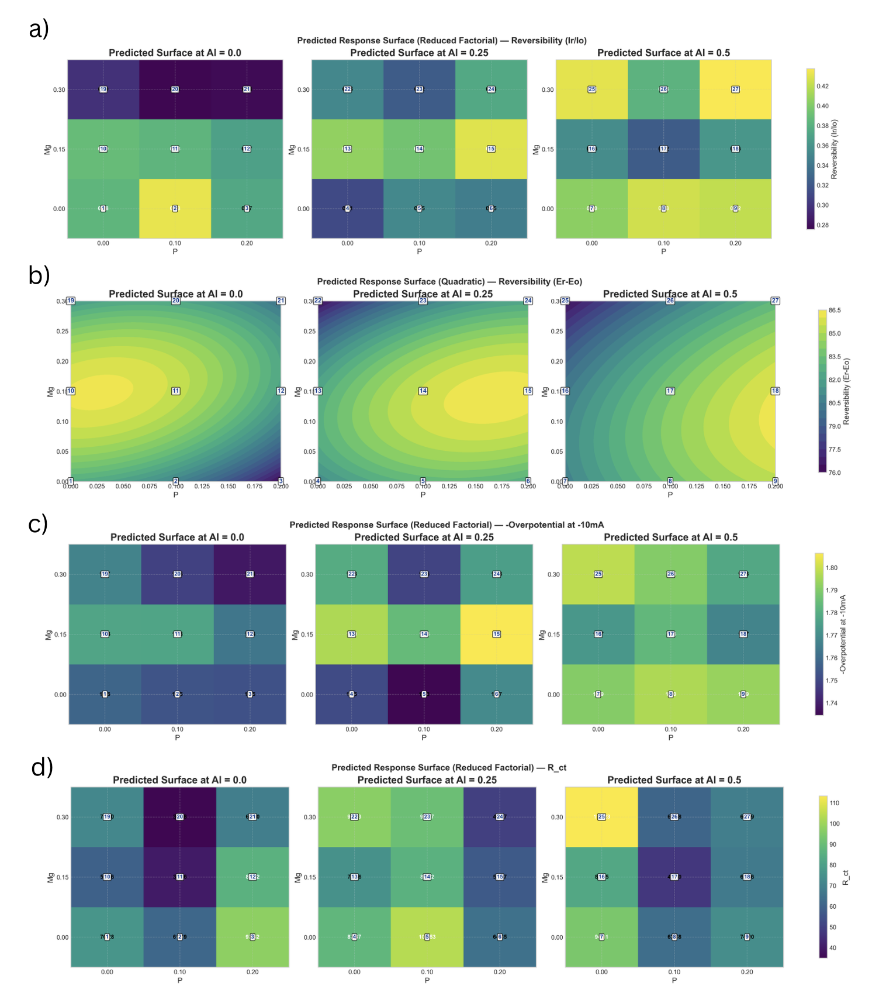

# Lead Acid Electrolyte Analysis

Modular, GitHub-ready version of the lead-acid electrolyte statistical analysis workflow.

## Attribution

- This repository is based on the following research article:
- **Electrochemical Performance Enhancement of Lead–Acid Batteries through Electrolyte Modification**
- **Article authors:** Fahimeh Gholami, Javad Asghari, Ali Pilehvar Meibody , Arash Ghazitabar, Shaahin Esfandiyari, Seyed Mehdi Orouji, Malek Naderi
- Main author of the Python code in this repository: **Ali Pilehvar Meibody**.
- **Code author affiliation:** Department of Applied Science and Technology, Politecnico di Torino, Torino, Italy; Graphene and Advanced Materials Laboratory (GAMLab.), Tehran, Iran.


### Abstract

Lead–acid battery performance is significantly constrained by negative-plate sulfation and parasitic hydrogen and oxygen evolution reactions at electrodes, all of which accelerate capacity fading and reduce service life. Additive engineering offers a direct approach to mitigate these degradation pathways. In this work, a simplified electrolyte formulation is proposed to simultaneously improve the behavior of both electrodes by influencing the interfacial kinetics at the anode and cathode. Although metal sulfates and mineral acids are known individual modifiers, their synergistic interactions remain insufficiently understood. To address this gap, a data-driven statistical framework combining Pearson correlation analysis, factorial and quadratic response-surface modeling, Type II ANOVA, effect size quantification, and multi-response composite scoring was developed alongside the electrochemical investigation to objectively quantify additive contributions and rank all formulations simultaneously.


`I_V.png`


Panels (a–d): cyclic voltammograms of 27 electrolyte formulations, with and without additives, for the first cycle at a scan rate of 10 mV/s.


Here, the combined effects of H3PO4, Al2(SO4)3, and MgSO4 were systematically evaluated over concentrations ranging from 0.1–0.5 wt.% for sulfate salts and 0.1–0.2 wt.% for phosphoric acid. Electrochemical (CV, LSV, EIS) and structural (XRD, FESEM) characterizations demonstrate that optimal combinations significantly enhance performance. Statistical modeling confirmed Al2(SO4)3 as the dominant factor across all responses, with the Mg×Al interaction as the only statistically significant ANOVA term for reversibility (F = 5.71, p = 0.018, eta_p^2 = 0.740), and the Al×P interaction as the controlling term for charge-transfer resistance (F = 3.71, p = 0.054, eta_p^2 = 0.650). Multi-response composite scoring across all 27 formulations provided an objective, data-driven basis for optimal sample selection.

Electrochemical evaluations of the negative electrode revealed that Al2(SO4)3 increases redox peak currents by 35–55%, decreases CV redox peak separation by 20–40%, and lowers charge-transfer resistance by 30–60%. Furthermore, synergistic mixing with H3PO4 and MgSO4 improves PbSO4 crystal refinement and interface stability, resulting in HER overpotential shifts of 80–120 mV and OER suppression of 50–90 mV. An optimum formulation (Sample 8) was validated in a 2 V, 200 Ah commercial cell, where cycle life increased by approximately 41% compared to the baseline electrolyte. These results highlight that targeted, statistically guided electrolyte formulation can effectively suppress sulfation and parasitic reactions, providing a practical and reproducible route toward longer-life, higher-efficiency lead–acid batteries.

### Keywords

Lead-acid battery; Electrolyte Additive; Magnesium sulfate; Phosphoric acid; Aluminum sulfate; Hydrogen Evolution Reaction.

## Project Structure

- `lead_acid_data.xlsx` — input workbook at the repository root. Sheet1 holds the measured responses for all 27 formulations (sample number, MgSO4, Al2(SO4)3, H3PO4, reversibility ratio, peak separation, overpotential, and charge-transfer resistance).
- `run_analysis.py` — command-line entry point. It reads the input workbook and writes every figure and workbook into the output directory.
- `src/lead_acid/config.py` — response names, optimization goals, and the `BEST_MODEL` mapping used for the preferred model and for Tables E1–E4.
- `src/lead_acid/data.py` — loads Sheet1 and builds the analysis table.
- `src/lead_acid/modeling.py` — reduced-factorial and quadratic OLS formulas (`get_formula`) and the fit helper for the preferred model.
- `src/lead_acid/pipeline.py` — end-to-end analysis: model comparison (Table 2), Type II ANOVA effect sizes (Tables E1–E4), composite-score ranking (Table D1), and the weighting sensitivity workbook.
- `src/lead_acid/plots.py` — correlation, diagnostic, heatmap, and response-surface figures.
- `src/lead_acid/style.py` — figure style and sample-label annotation helpers.
- `requirements.txt` — Python dependencies pinned to the versions used for the reproduction below.
- `RESULTS/` — saved outputs from the analysis that accompanies the manuscript. These files are the reference copies.
- `reproduced/` — fresh outputs created by the reproduction command. This directory is not part of the saved reference set.

## Setup

Tested with Python 3.13.2. From the repository root:

```bash
python3 -m venv .venv
source .venv/bin/activate
pip install -r requirements.txt
```

The packages installed by that command are pinned in `requirements.txt`. The scientific stack used for the verified run is pandas 3.1.1, numpy 2.5.4, matplotlib 3.11.2, statsmodels 0.15.0, scipy 1.18.1, patsy 1.0.3, formulaic 1.2.2, and openpyxl 3.1.5.

## Run

From the repository root, with the virtual environment activated:

```bash
MPLBACKEND=Agg python run_analysis.py --input lead_acid_data.xlsx --output reproduced
```

`--input` and `--output` both remain optional. The default input is `lead_acid_data.xlsx` in the repository root, and the default output directory is `outputs/lead_acid_stats_outputs`. Passing either flag overrides only that path.

The same command writes:

- `reproduced/10_model_comparison.xlsx` for Table 2
- `reproduced/17_composite_score_ranking.xlsx` for Table D1
- `reproduced/16_effect_size_summary.xlsx` for Tables E1–E4
- `reproduced/20_composite_score_sensitivity.xlsx` for the composite-score weighting analysis

### Manuscript tables

| Manuscript table | Generated workbook | Worksheet |
| --- | --- | --- |
| Table 2 | `reproduced/10_model_comparison.xlsx` | `Model_comparison` |
| Table D1 | `reproduced/17_composite_score_ranking.xlsx` | `Sheet1` |
| Table E1 | `reproduced/16_effect_size_summary.xlsx` | `RevRatio_effect_sizes` |
| Table E2 | `reproduced/16_effect_size_summary.xlsx` | `DeltaE_effect_sizes` |
| Table E3 | `reproduced/16_effect_size_summary.xlsx` | `Overpot_effect_sizes` |
| Table E4 | `reproduced/16_effect_size_summary.xlsx` | `Rct_effect_sizes` |

Table 2 reports R², adjusted R², AIC, and BIC for the reduced factorial model and the quadratic model. The preferred-model column follows `BEST_MODEL` in `src/lead_acid/config.py`. Tables E1–E4 are Type II ANOVA tables for that preferred model, including partial eta-squared. Table D1 ranks all 27 formulations by the equal-weight composite score. The sensitivity workbook uses worksheets `Summary` and `All_formulations`. A saved copy of that workbook is in `RESULTS/20_composite_score_sensitivity.xlsx`.

### Saved outputs and fresh outputs

`RESULTS/` is the archived output directory. It contains the workbooks and figures retained with the repository, including `RESULTS/10_model_comparison.xlsx`, `RESULTS/17_composite_score_ranking.xlsx`, and `RESULTS/16_effect_size_summary.xlsx`. `reproduced/` is created only when the command above is run. It is a new directory of the same analysis, suitable for checking that a clean environment reproduces the reference tables. The two directories are separate: replacing or deleting `reproduced/` does not change the saved files in `RESULTS/`.

## Notes

- The pipeline generates figures and summary Excel outputs in the selected output directory.
- Sample labels on scatter/surface figures are styled for visibility (bold, colored, outlined, optional boxed labels).

## RESULTS

Place generated analysis images in the `RESULTS/` folder.

### Correlation Matrix

`02_correlation_matrix.png`


## ARTICLE_FIG

Place manuscript/article figures in the `ARTICLE_FIG/` folder.


### Interaction Plot

`interaction_plot.png`



### Prediction Plot

`prediction_plot.png`



### Surface Response

`surface_response.png`


